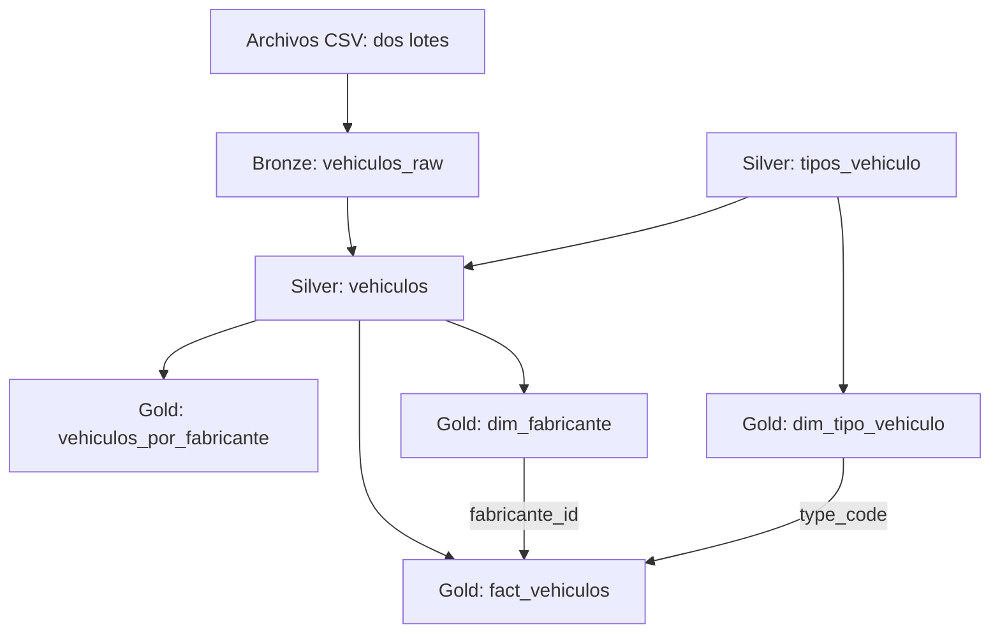
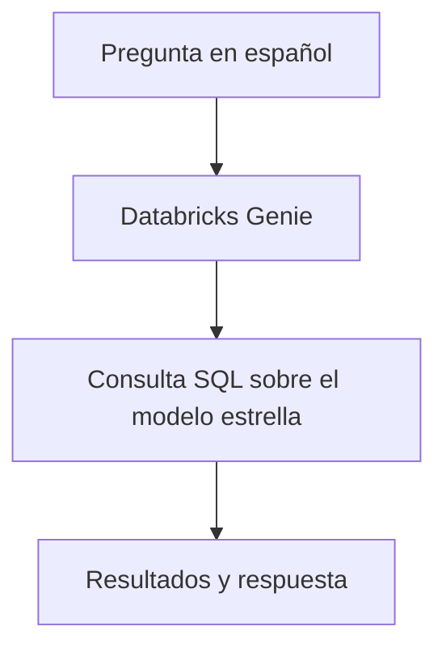
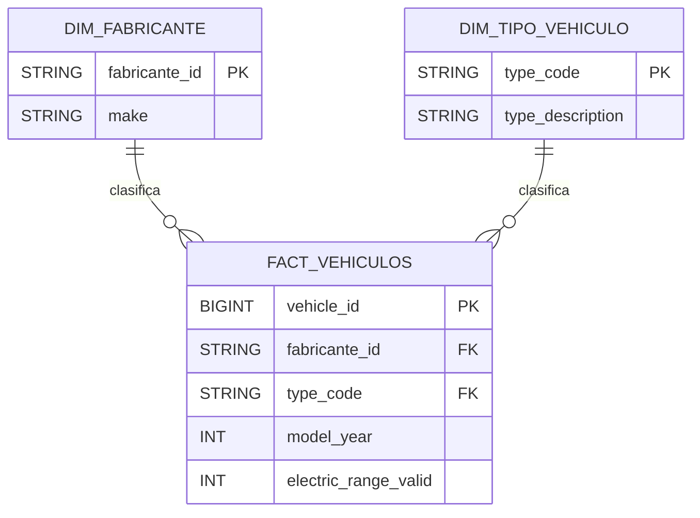
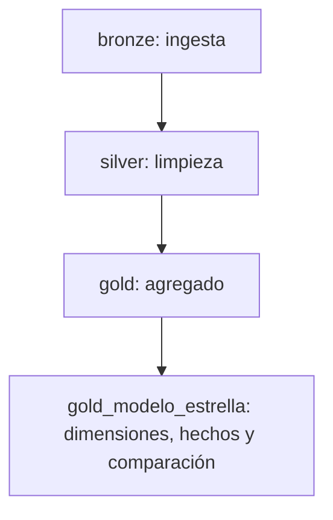

# Proyecto final · Vehículos eléctricos con Databricks

Proyecto del Módulo 4 de la Universidad Latina de Costa Rica.

Implementa un Lakehouse con capas Bronze, Silver y Gold para procesar datos de vehículos eléctricos, controlar su calidad, aplicar gobierno de datos y automatizar su ejecución.

Incluye un modelo estrella y un agente de consultas en lenguaje natural mediante Databricks Genie.

## 1. Problema y objetivo

El proyecto responde la siguiente pregunta:

**¿Cómo se distribuyen los vehículos del extracto por fabricante y tipo de vehículo eléctrico?**

Para responderla, se construye un proceso que:

- Ingiere archivos en dos lotes.
- Conserva los registros originales y su procedencia.
- Limpia datos y elimina duplicados.
- Enriquece los vehículos con su tipo y descripción.
- Calcula cantidades y porcentajes por fabricante y tipo.
- Construye un modelo estrella para consultas analíticas.
- Aplica controles de calidad, acceso y trazabilidad.
- Permite consultar el modelo estrella mediante preguntas en español.

Los resultados describen el extracto utilizado. No representan ventas, crecimiento mensual ni necesariamente la distribución de toda la población de vehículos eléctricos de Washington.

## 2. Fuente de datos

Se utiliza un extracto de **Electric Vehicle Population Data**, publicado por el Department of Licensing del estado de Washington.

Fuente oficial de referencia:

https://data.wa.gov/Transportation/Electric-Vehicle-Population-Data/f6w7-q2d2/about_data

El extracto contiene **30000 vehículos únicos**.

No se dispone de la fecha exacta de descarga ni del procedimiento de selección del extracto. Por ello, no se afirma que corresponda a la versión más reciente del conjunto oficial.

### Archivos utilizados

| Archivo | Filas | Descripción |
|---|---:|---|
| `ev_lote_1.csv` | 15000 | Primera carga. |
| `ev_lote_2.csv` | 15010 | Segunda carga con 15000 vehículos adicionales y 10 registros repetidos del primer lote. |

Los duplicados fueron agregados de forma controlada para demostrar la deduplicación en Silver.

Los encabezados se normalizaron utilizando nombres como `vehicle_id`, `vin_prefix`, `model_year` y `electric_range`.

### Identificación del vehículo

Se utiliza `vehicle_id` como clave de negocio.

`vin_prefix` contiene únicamente una parte del VIN y no identifica de forma única a todos los vehículos del extracto.

## 3. Arquitectura

Los objetos se organizan dentro del catálogo `pf_fallas`.

| Esquema | Función |
|---|---|
| `bronze` | Archivos de entrada y registros originales. |
| `silver` | Datos depurados y catálogo de tipos de vehículo. |
| `gold` | Agregado analítico y modelo estrella. |
| `seguridad` | Tabla de acceso y función de enmascaramiento. |

### Procesamiento de datos



Las relaciones entre las dimensiones y la tabla de hechos permiten analizar los vehículos por fabricante y tipo.

### Consulta mediante el agente



Genie utiliza únicamente las tres tablas configuradas del modelo estrella. El agente consulta los datos después de su actualización; no forma parte del Job de carga.

## 4. Estructura del repositorio

```text
m4-proyecto-ev/
├── README.md
├── databricks.yml
├── resources/
│   └── ev_job.yml
├── notebooks/
│   ├── 00_config.ipynb
│   ├── 01_bronze.ipynb
│   ├── 02_silver.ipynb
│   ├── 03_gold.ipynb
│   ├── 03_gold_job.ipynb
│   ├── 04_gobernanza.ipynb
│   ├── 05_observabilidad.ipynb
│   └── 06_modelo_estrella.ipynb
└── docs/
    ├── agente.md
    └── disparador.md
```

Repositorio:

https://github.com/josuerepos/m4-proyecto-ev

## 5. Componentes del proyecto

| Componente | Implementación |
|---|---|
| Ingesta incremental | Auto Loader con checkpoint y procesamiento `availableNow`. |
| Transformación Silver | Conversión de tipos, tratamiento de nulos, deduplicación y JOIN. |
| Calidad de Gold | Restricciones `NOT NULL` y `CHECK`, con prueba negativa. |
| Orquestación | Job con cuatro tareas dependientes y reintentos en Bronze. |
| Gobierno | Permisos, máscara de columna y tags. |
| Versionamiento | Rama `dev`, pull request y merge hacia `main`. |
| Despliegue | Databricks Asset Bundle con targets `dev` y `prod`. |
| Observabilidad | Consulta de linaje mediante tablas del sistema. |
| Optimización | Liquid Clustering por `make` y `OPTIMIZE` en Bronze. |
| O6 · Modelo estrella | Tabla de hechos, dos dimensiones, claves declaradas y consulta analítica. |
| O9 · Agente de consultas | Databricks Genie sobre las tres tablas del modelo estrella. |

## 6. Bronze · Ingesta incremental

Notebook: `01_bronze.ipynb`.

Tabla:

`pf_fallas.bronze.vehiculos_raw`

Los archivos se almacenan en el volumen:

`/Volumes/pf_fallas/bronze/landing/vehiculos/`

Distribución:

```text
vehiculos/
├── lote_1/
│   └── ev_lote_1.csv
└── lote_2/
    └── ev_lote_2.csv
```

Auto Loader identifica los archivos procesados mediante un checkpoint.

Ubicaciones utilizadas:

- Esquema: `/Volumes/pf_fallas/bronze/landing/_schemas/vehiculos_raw`
- Checkpoint: `/Volumes/pf_fallas/bronze/landing/_checkpoints/vehiculos_raw`

La ingesta agrega:

- `archivo_origen`: ruta del archivo del que proviene el registro.
- `fecha_ingesta`: momento en que el registro ingresó a Bronze.

### Validación incremental

1. Se procesó el primer lote: 15000 filas.
2. Se repitió la ejecución sin agregar archivos: el conteo no cambió.
3. Se agregó el segundo lote: 15010 filas adicionales.
4. Se repitió la ejecución: el conteo permaneció en 30010 filas.

El checkpoint evita reprocesar los mismos archivos en las condiciones probadas.

Los duplicados que existen dentro de los archivos se conservan en Bronze y se resuelven en Silver.

## 7. Silver · Limpieza y enriquecimiento

Notebook: `02_silver.ipynb`.

Tablas:

- `pf_fallas.silver.vehiculos`
- `pf_fallas.silver.tipos_vehiculo`

### Transformaciones

- Conversión de identificadores y campos numéricos mediante `TRY_CAST`.
- Eliminación de espacios innecesarios.
- Normalización de fabricante y estado.
- Sustitución de ciudades y condados vacíos por `SIN DATO`.
- Conservación de códigos postales y códigos censales como texto.
- Exclusión de registros sin un identificador de vehículo válido.
- Deduplicación mediante `ROW_NUMBER` por `vehicle_id`.
- Priorización por fecha de ingesta y archivo de origen.
- Enriquecimiento mediante `LEFT JOIN` con el catálogo de tipos.

La columna `electric_range_valid` conserva los rangos positivos y utiliza `NULL` para los demás valores. Esto permite calcular promedios sobre valores positivos sin modificar el rango original.

No se interpreta automáticamente un rango igual a cero como una autonomía real de cero.

### Catálogo de tipos

El catálogo se construye mediante SQL, sin un archivo CSV adicional.

| Código | Descripción | Vehículos |
|---|---|---:|
| BEV | Vehículo totalmente eléctrico | 23780 |
| PHEV | Vehículo híbrido enchufable | 6220 |

### Métricas antes y después

| Capa | Filas totales | Vehículos únicos | Registros repetidos | Ciudades sin tratar |
|---|---:|---:|---:|---:|
| Bronze | 30010 | 30000 | 10 | 4 |
| Silver | 30000 | 30000 | 0 | 0 |

## 8. Gold · Agregado y calidad

Notebooks:

- `03_gold.ipynb`: construcción del agregado y pruebas manuales.
- `03_gold_job.ipynb`: construcción del agregado para el Job.

Tabla:

`pf_fallas.gold.vehiculos_por_fabricante`

El agregado contiene:

- `make`
- `type_code`
- `total_vehiculos`
- `porcentaje_total`

### Resultados

| Indicador | Resultado |
|---|---:|
| Grupos de fabricante y tipo | 65 |
| Fabricantes | 44 |
| Total de vehículos | 30000 |

TESLA BEV es el grupo más numeroso, con **12396 vehículos**, equivalentes al **41,32 %** del extracto.

### Restricciones

Se aplican dos controles:

- `make NOT NULL`.
- `CHECK (total_vehiculos > 0)`, con nombre `cantidad_positiva`.

La prueba de inserción de una cantidad igual a `-1` fue rechazada con el error:

```text
[DELTA_VIOLATE_CONSTRAINT_WITH_VALUES]
CHECK constraint cantidad_positiva (total_vehiculos > 0) violated
```

La fila inválida no se incorporó a la tabla.

La prueba negativa se conserva para demostración manual en `03_gold.ipynb`. El Job utiliza `03_gold_job.ipynb`, que no ejecuta esa inserción intencionalmente inválida.

## 9. O6 · Modelo estrella

Notebook: `06_modelo_estrella.ipynb`.

El modelo estrella amplía la capa Gold utilizando los datos depurados de Silver.

### Grano

Una fila de `fact_vehiculos` representa un vehículo identificado por `vehicle_id` dentro del extracto.

El modelo no representa transacciones de venta ni conserva versiones históricas de cada vehículo.

### Tablas

| Tabla | Contenido | Filas |
|---|---|---:|
| `gold.dim_fabricante` | Una fila por fabricante. | 44 |
| `gold.dim_tipo_vehiculo` | Una fila por tipo de vehículo. | 2 |
| `gold.fact_vehiculos` | Una fila por vehículo. | 30000 |

### Dimensión de fabricantes

Columnas:

- `fabricante_id`
- `make`

`fabricante_id` se calcula mediante `SHA2(make, 256)`.

El mismo nombre normalizado produce el mismo identificador entre ejecuciones. Si cambia el nombre, cambia su identificador; este modelo no implementa seguimiento histórico de fabricantes.

### Dimensión de tipos

Columnas:

- `type_code`
- `type_description`

Se utiliza el código `BEV` o `PHEV` como clave.

### Tabla de hechos

Columnas:

- `vehicle_id`
- `fabricante_id`
- `type_code`
- `model_year`
- `electric_range_valid`

### Relaciones



### Claves declaradas

| Tabla | Restricción | Tipo |
|---|---|---|
| `dim_fabricante` | `pk_dim_fabricante` | PRIMARY KEY |
| `dim_tipo_vehiculo` | `pk_dim_tipo_vehiculo` | PRIMARY KEY |
| `fact_vehiculos` | `pk_fact_vehiculos` | PRIMARY KEY |
| `fact_vehiculos` | `fk_vehiculos_fabricante` | FOREIGN KEY |
| `fact_vehiculos` | `fk_vehiculos_tipo` | FOREIGN KEY |

Las claves primarias y foráneas son informativas en Databricks. Su declaración no sustituye las consultas de validación.

### Carga y validaciones

Las tablas se actualizan mediante `INSERT OVERWRITE` para evitar acumulación de filas entre ejecuciones.

La carga de hechos utiliza `LEFT JOIN` y claves dimensionales `NOT NULL`. Si falta una correspondencia, la inserción falla en lugar de descartar silenciosamente el vehículo.

La ejecución manual y las ejecuciones completas del Job en `dev` y `prod` confirmaron:

| Validación | Resultado |
|---|---:|
| Filas en hechos | 30000 |
| Vehículos únicos | 30000 |
| Registros repetidos | 0 |
| Fabricantes sin correspondencia | 0 |
| Tipos sin correspondencia | 0 |
| Diferencias respecto del agregado Gold | 0 |
| Claves primarias declaradas | 3 |
| Claves foráneas declaradas | 2 |

La consulta analítica combina hechos y ambas dimensiones para obtener cantidades y porcentajes por fabricante y tipo.

Devuelve los mismos 65 grupos del agregado Gold existente.

## 10. Orquestación y programación

Definición del Job:

`resources/ev_job.yml`

El flujo contiene cuatro tareas:



Las tareas `gold` y `gold_modelo_estrella` pertenecen a la capa Gold.

El modelo estrella se ejecuta después del agregado porque su notebook compara ambos resultados y necesita utilizar el agregado actualizado.

### Configuración

- Dependencias con condición `ALL_SUCCESS`.
- Dos reintentos en la tarea Bronze.
- Intervalo mínimo entre reintentos: 60000 milisegundos.
- Máximo de una ejecución simultánea por Job.

### Programación

| Target | Hora | Zona horaria | Estado configurado |
|---|---|---|---|
| `dev` | 08:00 | `America/Costa_Rica` | Pausado |
| `prod` | 08:00 | `America/Costa_Rica` | Activo |

Expresión Quartz:

```text
0 0 8 * * ?
```

La configuración base permanece pausada en `resources/ev_job.yml`. El target `prod` sobrescribe ese valor con `UNPAUSED` en `databricks.yml`.

### Estado de validación

- La versión actual de cuatro tareas se desplegó y ejecutó correctamente en `dev` y `prod`.
- Los resultados del modelo estrella se revisaron dentro de ambas ejecuciones.
- Se confirmaron 30000 vehículos únicos, cero referencias faltantes y cero diferencias con el agregado Gold.
- Se verificaron tres claves primarias y dos claves foráneas declaradas.

Las ejecuciones verificadas fueron iniciadas manualmente. No se utiliza una ejecución manual como evidencia de activación por horario.

## 11. Gobierno y seguridad

Notebook: `04_gobernanza.ipynb`.

### Permisos

Se configuró acceso de lectura al agregado Gold para `account users`, incluyendo los permisos necesarios sobre catálogo, esquema y tabla.

La consulta `SHOW GRANTS` confirmó el permiso:

```text
account users | SELECT | TABLE | pf_fallas.gold.vehiculos_por_fabricante
```

Esta evidencia corresponde al agregado indicado. No implica que se haya otorgado el mismo acceso a todas las tablas del modelo estrella.

### Enmascaramiento

Objetos utilizados:

- Tabla de acceso: `pf_fallas.seguridad.acceso_vin`.
- Función: `pf_fallas.seguridad.enmascarar_vin`.
- Columna protegida: `pf_fallas.silver.vehiculos.vin_prefix`.

La tabla de acceso determina si el usuario puede visualizar el valor original.

| Condición | Resultado |
|---|---|
| Usuario autorizado | Valor original de `vin_prefix`. |
| Usuario sin autorización | `RESTRINGIDO`. |

La prueba se realizó cambiando la autorización del mismo usuario y restaurándola al finalizar. No se presenta como una prueba con dos identidades distintas.

La máscara se utiliza para demostrar el mecanismo de control sobre una columna seleccionada del conjunto público.

### Tags

| Columna | Tag | Valor |
|---|---|---|
| `vehicle_id` | `clasificacion_proyecto` | `identificador_vehiculo` |
| `vin_prefix` | `clasificacion_proyecto` | `identificador_restringido` |

Los tags describen la clasificación del proyecto. No aplican por sí solos el enmascaramiento.

### Acceso desde Genie

Genie consulta las fuentes configuradas utilizando los permisos de datos correspondientes al usuario.

Las instrucciones del agente orientan sus respuestas, pero no sustituyen los controles de acceso de Unity Catalog.

El modelo estrella no incluye `vin_prefix`. Por ello, las consultas del agente no demuestran la máscara aplicada en Silver.

## 12. Observabilidad y optimización

Notebook: `05_observabilidad.ipynb`.

### Linaje

Se consultó `system.access.table_lineage` para comprobar las relaciones:

| Origen | Destino |
|---|---|
| `bronze.vehiculos_raw` | `silver.vehiculos` |
| `silver.tipos_vehiculo` | `silver.vehiculos` |
| `silver.vehiculos` | `gold.vehiculos_por_fabricante` |

Se observaron ejecuciones de tipo `NOTEBOOK` y `JOB`.

Este resultado corresponde al flujo original validado. La ampliación O6 agrega nuevas lecturas y escrituras que pueden consultarse en el linaje después de su ejecución y disponibilidad en la tabla del sistema.

### Liquid Clustering

Se seleccionó Bronze por ser la tabla de mayor tamaño entre las comparadas durante la evaluación.

Se ejecutó:

```sql
ALTER TABLE pf_fallas.bronze.vehiculos_raw
CLUSTER BY (make);

OPTIMIZE pf_fallas.bronze.vehiculos_raw;
```

La verificación con `DESCRIBE DETAIL` mostró:

- `clusteringColumns`: `["make"]`.
- La característica `clustering` dentro de `tableFeatures`.
- Un archivo después de la compactación.

`clusterByAuto = false` indica que las columnas de clustering se eligieron manualmente.

Después de la optimización se conservaron las 30010 filas y los 30000 vehículos únicos.

No se realizó una prueba comparativa de latencia, por lo que no se afirma una mejora de tiempo de consulta medida.

## 13. O9 · Agente de consultas con Databricks Genie

Documentación: `docs/agente.md`.

Se configuró un Genie Agent para responder preguntas en español sobre el modelo estrella.

### Fuentes

Se agregaron únicamente:

- `pf_fallas.gold.fact_vehiculos`
- `pf_fallas.gold.dim_fabricante`
- `pf_fallas.gold.dim_tipo_vehiculo`

No se agregó el agregado `vehiculos_por_fabricante`, para que las consultas analíticas se construyan desde los hechos y sus dimensiones.

### Funcionamiento

1. El usuario escribe una pregunta en lenguaje natural.
2. Genie interpreta la solicitud y genera una consulta SQL.
3. La consulta se ejecuta sobre las fuentes configuradas.
4. El agente presenta los resultados y una respuesta.
5. El usuario revisa el SQL y la información obtenida.

También se pueden solicitar visualizaciones. La forma de presentar el resultado depende de la pregunta y de las capacidades disponibles en la interfaz.

### Instrucciones configuradas

Se proporcionó contexto para:

- Responder en español.
- Utilizar las tres tablas seleccionadas.
- Relacionar hechos y dimensiones mediante sus claves.
- Calcular las respuestas consultando los datos.
- Contar vehículos desde la tabla de hechos.
- Distinguir BEV y PHEV.
- Interpretar `model_year` como año del modelo, no como fecha de venta.
- Expresar la autonomía eléctrica en millas.
- Tratar los valores nulos de autonomía como información no disponible.
- Explicar el denominador de los porcentajes.
- Pedir aclaraciones ante preguntas ambiguas.
- Reconocer preguntas que no pueden responderse con las fuentes disponibles.

### Preguntas verificadas

| Pregunta | Resultado confirmado |
|---|---|
| ¿Cuántos vehículos hay en total? | 30000 |
| ¿Cuántos fabricantes distintos tienen vehículos en el extracto? | 44 |
| ¿Cuántos vehículos hay de cada tipo? | BEV: 23780; PHEV: 6220 |
| ¿Cuántos vehículos TESLA son BEV y qué porcentaje representan del total? | 12396; 41,32 % |
| ¿Cuántos vehículos se vendieron durante septiembre de 2026? | Reconoció que no existe información de ventas en el modelo. |

Los resultados numéricos coinciden con las validaciones del modelo estrella.

Las cinco pruebas reportadas no necesitaron correcciones de resultados. Esto no garantiza que todas las preguntas futuras produzcan respuestas correctas.

### Ejemplos adicionales

- ¿Cuáles son las cinco marcas con más vehículos?
- ¿Cuál es la autonomía eléctrica promedio por fabricante?
- ¿Cuántos vehículos BEV tiene cada fabricante?
- Muestra un gráfico de barras con la cantidad de vehículos BEV y PHEV.

Los ejemplos adicionales describen posibilidades de consulta; no se presentan como pruebas verificadas.

### Reproducción y versionamiento

El agente se configura como un objeto dentro del workspace de Databricks.

`docs/agente.md` documenta sus fuentes, relaciones, instrucciones, pruebas y limitaciones.

El bundle actual despliega el Job y sus archivos. No crea ni despliega automáticamente el agente Genie.

La configuración de Genie debe recrearse siguiendo la documentación si se utiliza otro workspace.

## 14. Git y despliegue

El proyecto utiliza:

- Rama `dev` para cambios.
- Pull request desde `dev` hacia `main`.
- Rama `main` como versión integrada.
- Databricks Asset Bundle para despliegues.

Archivos de configuración:

- `databricks.yml`
- `resources/ev_job.yml`

El bundle se llama `m4_proyecto_ev` y contiene los targets `dev` y `prod`.

### Flujo de trabajo

1. Editar en la rama `dev`.
2. Desplegar y probar en el target `dev` cuando cambie el código o la configuración del Job.
3. Revisar código, resultados y documentación.
4. Hacer commit y push.
5. Crear el pull request con base `main` y comparación `dev`.
6. Integrar el pull request.
7. Actualizar la carpeta de `main` mediante Pull.
8. Desplegar en el target `prod` cuando corresponda.
9. Ejecutar y verificar el Job después de cambios funcionales.

Los despliegues se realizan desde Databricks. No se implementó automatización con GitHub Actions.

Los cambios exclusivamente de documentación no requieren volver a ejecutar el Job.

### Separación de targets

Los targets tienen configuraciones y Jobs diferenciados, pero utilizan el mismo catálogo `pf_fallas`, las mismas tablas y el mismo checkpoint.

Por tanto, no existe aislamiento de datos entre desarrollo y producción.

Se evita ejecutar simultáneamente Jobs de ambos targets sobre estos objetos.

El límite `max_concurrent_runs: 1` se aplica a cada Job por separado; no coordina la concurrencia entre Jobs distintos.

## 15. Cómo ejecutar el proyecto

### Requisitos

- Workspace de Databricks con Unity Catalog.
- Permisos para crear y utilizar los objetos del proyecto.
- Carpeta Git conectada al repositorio.
- Los dos archivos CSV utilizados.
- Cómputo compatible con los notebooks.
- Genie Agents disponible y un SQL warehouse para sus consultas.

### Preparación inicial

1. Revisar y ejecutar `00_config.ipynb`.
2. Confirmar la existencia del catálogo, esquemas y volumen.
3. Colocar inicialmente `ev_lote_1.csv` dentro de `lote_1`.
4. Ejecutar `01_bronze.ipynb`.
5. Repetir la ingesta sin archivos nuevos y comprobar que el conteo no cambia.
6. Agregar `ev_lote_2.csv` dentro de `lote_2`.
7. Repetir la ingesta y verificar las 30010 filas.
8. Ejecutar `02_silver.ipynb`.
9. Ejecutar `03_gold.ipynb` y revisar sus controles.
10. Ejecutar `04_gobernanza.ipynb` para configurar y probar la seguridad.
11. Ejecutar `05_observabilidad.ipynb` para revisar linaje y optimización.
12. Ejecutar `06_modelo_estrella.ipynb` y comprobar sus resultados.
13. Configurar Genie siguiendo `docs/agente.md`.
14. Ejecutar las preguntas de validación del agente.

La inserción inválida de `03_gold.ipynb` debe fallar de forma intencional. Ese error demuestra el funcionamiento del control de calidad.

### Ejecución habitual

Una vez preparados los datos y objetos:

1. Desplegar el bundle si hay cambios funcionales pendientes.
2. Abrir el Job del target correspondiente.
3. Ejecutar las cuatro tareas o esperar la programación configurada.
4. Revisar el estado y los resultados de las consultas.
5. Abrir Genie para consultar el modelo estrella actualizado.

El Job no ejecuta los notebooks de configuración, gobierno u observabilidad.

No se debe borrar el checkpoint para una ejecución habitual. Tampoco se deben modificar archivos ya procesados esperando que Auto Loader los trate como archivos nuevos.

## 16. Evidencias para la demostración

Las evidencias se revisan directamente en Databricks mediante notebooks, metadatos, conversaciones del agente y resultados de ejecuciones.

| Evidencia | Ubicación |
|---|---|
| Ingesta por lotes y procedencia | `01_bronze.ipynb` |
| Métricas Bronze frente a Silver | `02_silver.ipynb` |
| JOIN con tipos de vehículo | `02_silver.ipynb` |
| Agregado y restricciones | `03_gold.ipynb` |
| Rechazo de cantidad negativa | `03_gold.ipynb` |
| Ejecución de las cuatro tareas | Runs de los Jobs de `dev` y `prod` |
| Configuración del horario | Configuración del Job de `prod` |
| Permisos, máscara y tags | `04_gobernanza.ipynb` |
| Linaje y Liquid Clustering | `05_observabilidad.ipynb` |
| Modelo estrella y claves | `06_modelo_estrella.ipynb` |
| Comparación entre modelo y agregado | Celda 9 de `06_modelo_estrella.ipynb` |
| Preguntas y respuestas del agente | Conversaciones de Genie |
| Configuración y pruebas de O9 | `docs/agente.md` |
| Versionamiento e integración | Historial y pull requests de GitHub |
| Configuración de despliegue | `databricks.yml` y `resources/ev_job.yml` |

Las consultas de validación del modelo muestran resultados para revisión.

La ejecución exitosa del notebook confirma que las instrucciones terminaron; la revisión de sus salidas confirma que los indicadores coinciden con lo esperado.

En Genie se revisan las respuestas y las consultas que las respaldan.

## 17. Decisiones y limitaciones

- Se conserva Bronze como registro de entrada, incluidos los duplicados.
- Se utiliza `vehicle_id` como clave de negocio.
- Los diez duplicados se agregaron para demostrar la limpieza.
- Se conserva el rango eléctrico original y se agrega una versión válida para análisis.
- Se mantiene el agregado Gold y se amplía la capa con el modelo estrella.
- El modelo estrella utiliza dos dimensiones y un grano explícito.
- Las claves PK y FK son informativas y se acompañan de verificaciones.
- Las tablas del modelo estrella se reconstruyen mediante `INSERT OVERWRITE`.
- No se implementa CDC ni historial SCD Tipo 2.
- No se agrega una dimensión temporal porque no existe una fecha de evento de negocio documentada para ese propósito.
- Los targets `dev` y `prod` comparten datos y checkpoint.
- Las pruebas de acceso se realizaron con una identidad.
- El proceso de despliegue es manual desde Databricks.
- Las ejecuciones del Job verificadas fueron iniciadas manualmente.
- Genie utiliza únicamente las tres tablas configuradas del modelo estrella.
- El agente no se despliega automáticamente mediante el bundle actual.
- Las instrucciones del agente no sustituyen los permisos de Unity Catalog.
- Las respuestas generadas requieren revisión.
- O9 se validó mediante cuatro preguntas de datos y una prueba de límites.