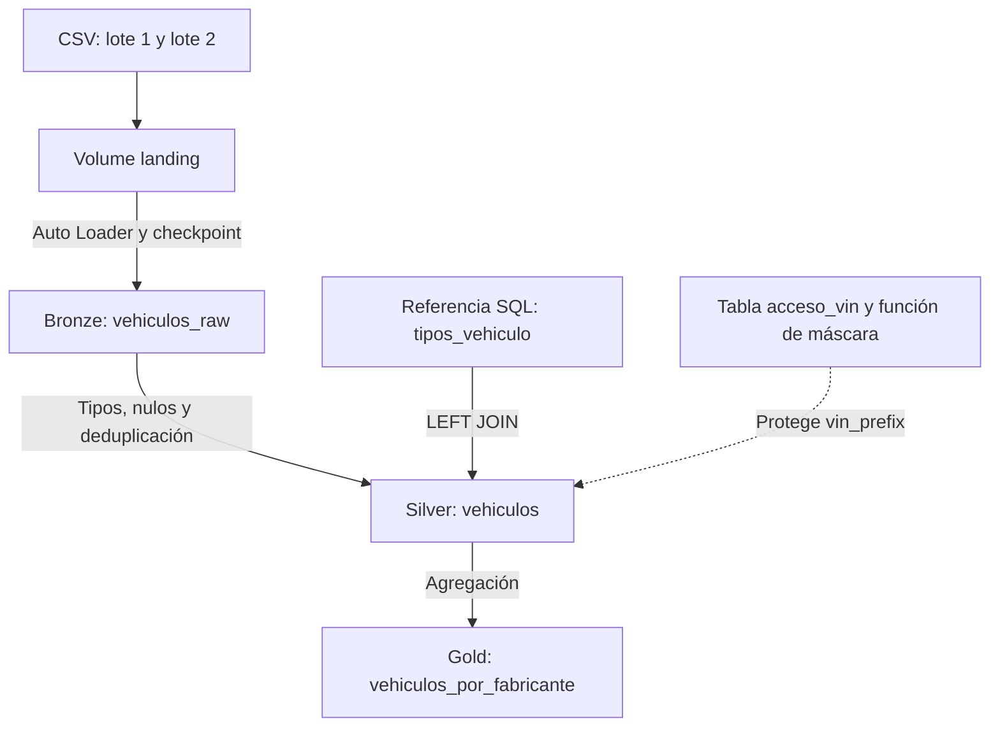

# m4-proyecto-ev
Pipeline de vehículos eléctricos en Databricks con arquitectura Bronze, Silver y Gold, calidad de datos, gobernanza con Unity Catalog y despliegue mediante bundles.

# Vehículos eléctricos: pipeline con Databricks y Unity Catalog

Pipeline académico en Databricks Free Edition que transforma archivos CSV en datos limpios y un resumen por fabricante. Integra ingesta incremental, controles de calidad, orquestación, gobernanza, control de versiones y optimización.

## Problema y pregunta de negocio

Los archivos de entrada pueden contener ubicaciones vacías y vehículos repetidos entre lotes. El proyecto conserva lo recibido en Bronze y produce una versión deduplicada y enriquecida en Silver antes de generar indicadores en Gold.

**¿Qué fabricantes concentran más vehículos y cómo se distribuyen entre eléctricos puros (BEV) e híbridos enchufables (PHEV)?**

El grano de Silver es un vehículo por `vehicle_id`. El grano de Gold es una combinación de fabricante y tipo de vehículo. El porcentaje de Gold usa como denominador todos los vehículos del extracto.

## Fuente y alcance

- Fuente de referencia: [Electric Vehicle Population Data, Data.WA](https://data.wa.gov/Transportation/Electric-Vehicle-Population-Data/f6w7-q2d2/about_data).
- Entidad responsable: Washington State Department of Licensing (DOL).
- Se utilizó un extracto aportado para el proyecto con 30.000 vehículos y 16 columnas originales. La estructura coincide con el dataset público; la fecha de extracción y el procedimiento de selección de esas filas no quedaron registrados.
- La fuente describe vehículos BEV y PHEV registrados a través del DOL. El extracto incluye algunos registros con estado distinto de WA, que se conservaron.
- No se interpreta el extracto como ventas, evolución mensual ni muestra estadísticamente representativa de toda la población.
- Preparación: normalización de encabezados y división en dos CSV. Se agregaron 10 copias exactas de registros del primer lote al segundo para demostrar deduplicación.

| Archivo | Registros |
|---|---:|
| `ev_lote_1.csv` | 15.000 |
| `ev_lote_2.csv` | 15.010 |
| Total recibido | 30.010 |
| Vehículos únicos | 30.000 |

## Arquitectura

El catálogo `pf_fallas` contiene los esquemas `bronze`, `silver`, `gold` y `seguridad`. El Job ejecuta tres tareas dependientes: `bronze`, `silver` y `gold`. La gobernanza y el análisis de observabilidad se ejecutan mediante notebooks separados.

## Componentes elegidos

Se implementaron V1, V2 y los cinco componentes C1–C5. No se utilizaron temas opcionales como reemplazo.

| Parte | Implementación | Evidencia obtenida |
|---|---|---|
| V1 Bronze | Auto Loader CSV, esquema persistente, checkpoint y archivo de origen | Reejecutar sin archivos nuevos no aumentó el conteo; segundo lote incorporado por separado |
| V2 Silver | Conversiones, tratamiento de vacíos, ROW_NUMBER y LEFT JOIN | 30.000 vehículos únicos y cero duplicados |
| C1 Gold y calidad | Tabla Delta, `make NOT NULL` y `CHECK total_vehiculos > 0` | INSERT con -1 rechazado con error literal |
| C2 Orquestación | Tres tareas, dependencias, dos reintentos en Bronze y programación declarada | Corridas completas exitosas; activar y verificar el disparador definitivo según guía de cierre |
| C3 Gobernanza | Grants de lectura, máscara con mapeo y tags | VIN visible/RESTRINGIDO al cambiar el mapeo; máscara y tags conservados tras el Job |
| C4 Versionado y despliegue | Git folder, ramas dev/main, PR y bundle con dos targets | Despliegues y corridas exitosos en dev y prod |
| C5 Observabilidad y optimización | Consulta de linaje y liquid clustering por make en Bronze | DESCRIBE DETAIL, historial OPTIMIZE y conteos conservados |

## Decisiones de diseño

1. **Bronze conserva lo recibido:** columnas del CSV como texto, duplicados incluidos y metadatos `archivo_origen` y `fecha_ingesta`.
2. **Incrementalidad por archivos:** Auto Loader utiliza un checkpoint persistente. La deduplicación por vehículo se realiza posteriormente en Silver.
3. **Llave de negocio:** `vehicle_id` proviene de DOL Vehicle ID. El VIN parcial no es único.
4. **Nulos:** ciudad y condado vacíos se reemplazan por `SIN DATO`; otros nulos se conservan cuando no existe información fiable para completarlos.
5. **Autonomía:** se conserva `electric_range`; `electric_range_valid` contiene solo valores positivos para futuros promedios. Es una regla analítica explícita, no una modificación del valor original.
6. **Deduplicación:** ROW_NUMBER por `vehicle_id`, priorizando primera ingesta y archivo de origen. Las diez copias de prueba son idénticas; no se implementa CDC.
7. **Enriquecimiento:** referencia SQL de dos tipos con sigla y descripción en español; LEFT JOIN evita descartar registros sin coincidencia.
8. **Gold persistente:** tabla Delta con resumen y restricciones aplicadas. Los porcentajes se redondean a dos decimales y pueden no sumar exactamente 100.
9. **Gobernanza:** `account users` recibió USE CATALOG, USE SCHEMA de Gold y SELECT en su tabla. Estos grants no revocan privilegios previos o heredados. La tabla de mapeo no se comparte con ese perfil.
10. **Máscara:** `seguridad.enmascarar_vin` consulta `seguridad.acceso_vin` para `current_user()`. Sin autorización devuelve `RESTRINGIDO`. La clasificación de identificadores es académica sobre datos públicos; los tags son descriptivos y no aplican la máscara por sí solos.
11. **Clustering:** Bronze era la tabla más grande por tamaño físico; se eligió `make` para consultas filtradas por fabricante. No se afirma una mejora de latencia medida con este volumen pequeño.

## Resultados verificados

| Indicador | Bronze | Silver |
|---|---:|---:|
| Filas | 30.010 | 30.000 |
| Vehículos únicos | 30.000 | 30.000 |
| Registros repetidos | 10 | 0 |
| Ciudades nulas o vacías sin tratar | 4 | 0 |

Silver contiene 23.780 BEV y 6.220 PHEV. Gold tiene 65 combinaciones, 44 fabricantes y suma 30.000 vehículos. TESLA/BEV representa 12.396 vehículos y 41,32% del extracto.

Bronze pasó de 2 archivos y 528.580 bytes a 1 archivo y 510.208 bytes después de OPTIMIZE. `clusteringColumns` muestra `["make"]`. El conteo permaneció en 30.010 filas y 30.000 vehículos únicos.

## Organización del código

| Archivo | Propósito |
|---|---|
| `notebooks/00_config.ipynb` | Crear catálogo, esquemas, volume y carpetas |
| `notebooks/01_bronze.ipynb` | Ingesta incremental y evidencia por lote |
| `notebooks/02_silver.ipynb` | Referencia SQL, limpieza, deduplicación, JOIN y métricas |
| `notebooks/03_gold.ipynb` | Resumen y prueba negativa manual |
| `notebooks/03_gold_job.ipynb` | Gold sin INSERT negativo para ejecución automática |
| `notebooks/04_gobernanza.ipynb` | Grants, mapeo, máscara y tags |
| `notebooks/05_observabilidad.ipynb` | Linaje, tamaños, clustering y optimización |
| `databricks.yml` | Bundle `m4_proyecto_ev`, targets dev/prod |
| `resources/ev_job.yml` | Job, tareas, reintentos y programación |

## Cómo ejecutar

### Primera preparación

1. Clonar este repositorio como Git folder en el Workspace y trabajar con una identidad con permisos para crear los objetos.
2. Ejecutar `00_config` adaptado a `pf_fallas`; no ejecutar el generador Bakehouse de la plantilla original.
3. Cargar únicamente `ev_lote_1.csv` en `/Volumes/pf_fallas/bronze/landing/vehiculos/lote_1/`.
4. Ejecutar `01_bronze`: esperar 15.000 filas. Repetir sin archivos nuevos: esperar el mismo conteo.
5. Subir `ev_lote_2.csv` a `/Volumes/pf_fallas/bronze/landing/vehiculos/lote_2/` y ejecutar Bronze: esperar 30.010 filas.
6. Ejecutar `02_silver` y `03_gold_job`; comprobar las métricas anteriores.
7. Ejecutar `04_gobernanza` en orden. Las celdas de demostración desactivan y restauran la autorización; finalizar con `puede_ver_vin=true` para el usuario autorizado.
8. Ejecutar `05_observabilidad` para consultar linaje y evidenciar clustering/OPTIMIZE.
9. Ejecutar manualmente el INSERT inválido de `03_gold` y conservar el error como evidencia. Esa celda está excluida del Job.

Los CSV deben estar disponibles antes de iniciar una instalación nueva. No se afirma que estén incluidos en el repositorio. No borrar el checkpoint mientras se conserve la tabla Bronze para la prueba incremental.

### Bundle y Jobs

En el editor de Databricks, abrir Deployments, seleccionar `dev` y desplegar. Ejecutar el Job y verificar las tres tareas. Integrar cambios mediante PR a `main`, sincronizar y desplegar `prod`. Jobs: `[dev josuefallas] m4_ev_dev` y `m4_ev_prod`.

Los targets separan los despliegues, pero comparten los datos en `pf_fallas` y el checkpoint. No ejecutar Jobs manual/dev/prod simultáneamente. La programación se declaró diaria a las 08:00 `America/Costa_Rica`, inicialmente pausada. Su activación definitiva debe verificarse en el Job tras aplicar el cambio del YAML y redesplegar.

El despliegue dev observado es source-linked y referencia el Git folder de trabajo. Prod sube archivos al destino del bundle. Los cambios se hacen en el repositorio y luego se despliegan, no editando la copia de prod.

## Flujo de cambios

Trabajo en `dev` → Commit & Push → Pull request → revisión y merge a `main` → Pull en Databricks → despliegue manual del target prod.

No hay GitHub Actions configurado ni despliegue automático al merge. El proyecto demuestra versionado y despliegue declarativo con bundles.

## Evidencias

Las salidas verificadas se consultan en los notebooks y las corridas de Jobs en Databricks. [PR #2: observabilidad y liquid clustering](https://github.com/josuerepos/m4-proyecto-ev/pull/2).

La guía `docs/presentacion.md` indica las capturas que deben añadirse al README y cómo presentar cada componente. Las capturas y URLs de runs todavía deben incorporarse; no se incluyen imágenes ficticias ni enlaces a ejecuciones no registrados.

## Limitaciones

- Extracto académico de 30.000 vehículos; fecha y método de selección no registrados.
- Duplicados controlados; no se simula una fuente de actualizaciones CDC.
- Una misma identidad se utilizó para probar el cambio del mapeo; no se afirma prueba con segunda cuenta.
- Sin aislamiento de catálogos o checkpoints entre targets.
- Optimización demostrada por metadatos e historial, sin benchmark de rendimiento.

Proyecto final del Módulo 4, Técnico en Ingeniería de Datos con Databricks, Universidad Latina de Costa Rica.
