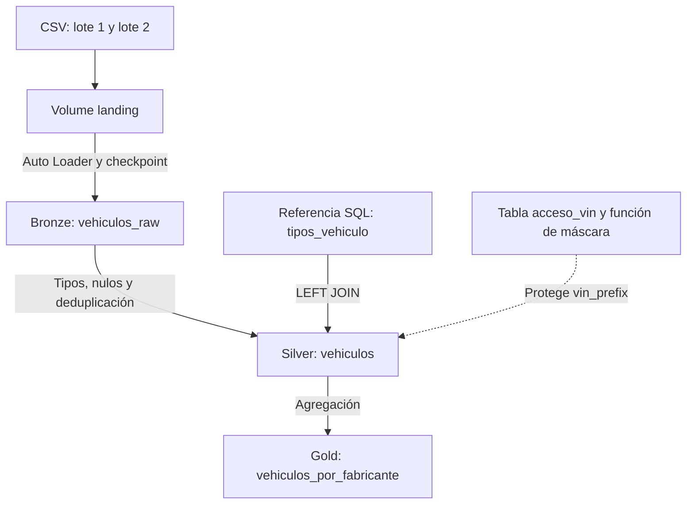

# Vehículos eléctricos: pipeline con Databricks y Unity Catalog

Proyecto académico desarrollado en Databricks Free Edition que transforma archivos CSV en datos limpios y un resumen por fabricante y tipo de vehículo.

Incluye ingesta incremental, calidad de datos, orquestación, gobernanza, control de versiones, despliegue con bundles y optimización.

## 1. Problema y pregunta de negocio

Los archivos recibidos pueden contener ubicaciones vacías y vehículos repetidos entre lotes. El pipeline conserva los datos recibidos en Bronze, los limpia y enriquece en Silver y genera indicadores en Gold.

**Pregunta de negocio:**

¿Qué fabricantes concentran más vehículos y cómo se distribuyen entre eléctricos puros (`BEV`) e híbridos enchufables (`PHEV`)?

Cada fila de Silver representa un vehículo identificado por `vehicle_id`. Cada fila de Gold representa una combinación de fabricante y tipo de vehículo.

## 2. Fuente y alcance de los datos

- **Dataset de referencia:** [Electric Vehicle Population Data](https://data.wa.gov/Transportation/Electric-Vehicle-Population-Data/f6w7-q2d2/about_data).
- **Portal:** Data.WA, Estado de Washington.
- **Entidad responsable:** Washington State Department of Licensing (`DOL`).
- **Extracto utilizado:** 30.000 vehículos y 16 columnas originales.
- **Fecha y método de selección del extracto:** no registrados.

La estructura del archivo utilizado coincide con el dataset público. Los datos describen vehículos eléctricos puros e híbridos enchufables registrados a través del DOL.

El extracto incluye algunos registros cuyo estado es distinto de `WA`; estos se conservaron.

Los resultados describen únicamente los vehículos del extracto. No representan ventas, crecimiento mensual ni una muestra estadísticamente representativa de toda la población.

### Preparación de los archivos

Se normalizaron los nombres de las columnas y se dividieron los datos en dos lotes. Para demostrar la deduplicación, se agregaron al segundo lote 10 copias exactas de registros del primero.

| Archivo | Registros |
|---|---:|
| `ev_lote_1.csv` | 15.000 |
| `ev_lote_2.csv` | 15.010 |
| **Total recibido** | **30.010** |
| **Vehículos únicos** | **30.000** |

## 3. Arquitectura

El catálogo `pf_fallas` contiene los siguientes esquemas:

| Esquema | Propósito |
|---|---|
| `bronze` | Conservar los registros recibidos y el volume de entrada |
| `silver` | Almacenar vehículos limpios y la referencia de tipos |
| `gold` | Almacenar el resumen por fabricante y tipo |
| `seguridad` | Mantener la tabla de acceso y la función de enmascaramiento |

El Job ejecuta tres tareas dependientes: `bronze`, `silver` y `gold`. La gobernanza y la observabilidad se administran mediante notebooks separados.

## 4. Componentes implementados

Se implementaron la columna vertebral `V1–V2` y los cinco componentes `C1–C5`. No se utilizaron temas opcionales como reemplazo.

| Parte | Implementación | Evidencia obtenida |
|---|---|---|
| V1 · Bronze | Auto Loader CSV, esquema persistente, checkpoint y archivo de origen | Reejecutar sin archivos nuevos conservó el conteo; el segundo lote se incorporó por separado |
| V2 · Silver | Conversiones, tratamiento de vacíos, deduplicación y `LEFT JOIN` | 30.000 vehículos únicos, cero duplicados y tipos enriquecidos |
| C1 · Gold y calidad | Tabla Delta, `make NOT NULL` y `CHECK total_vehiculos > 0` | Inserción con cantidad `-1` rechazada con error literal |
| C2 · Orquestación | Tres tareas, dependencias, dos reintentos en Bronze y programación diaria | Corridas completas exitosas y disparador de prod activo a las 08:00, America/Costa_Rica |
| C3 · Gobernanza | Permisos de lectura, máscara con tabla de mapeo y tags | VIN visible o restringido según autorización; máscara y tags conservados después del Job |
| C4 · Versionado y despliegue | Git folder, ramas `dev` y `main`, pull requests y bundle con dos targets | Despliegues y corridas exitosas en `dev` y `prod` |
| C5 · Observabilidad y optimización | Consulta de linaje y liquid clustering por `make` en Bronze | Configuración verificada, historial de `OPTIMIZE` y conteos conservados |

## 5. Decisiones de diseño

### Bronze: conservar los datos recibidos

Las columnas del CSV se ingieren como texto. Se conservan los duplicados y se agregan:

- `archivo_origen`: archivo del que provino cada fila.
- `fecha_ingesta`: momento en que se incorporó el registro.

Auto Loader utiliza un checkpoint persistente para reconocer los archivos procesados. Esto evita volver a cargar el mismo archivo, pero no elimina vehículos repetidos entre archivos diferentes.

### Silver: limpiar y enriquecer

- Se utiliza `vehicle_id`, proveniente de `DOL Vehicle ID`, como llave de negocio.
- El VIN parcial no se utiliza como llave porque no es único.
- Se convierten identificadores, años y cantidades a los tipos correspondientes.
- Los códigos postales y las zonas censales se conservan como texto.
- Los valores vacíos de ciudad y condado se reemplazan por `SIN DATO`.
- Otros nulos se conservan cuando no existe información confiable para completarlos.
- Se aplica `ROW_NUMBER()` por `vehicle_id`, conservando la primera ingesta.
- Se realiza un `LEFT JOIN` con una referencia creada mediante SQL para agregar `type_code` y `type_description`.

Se conserva la autonomía original en `electric_range`. La columna adicional `electric_range_valid` contiene únicamente valores positivos para futuros promedios. Esta es una regla analítica documentada.

No se implementa CDC: los duplicados controlados son copias idénticas utilizadas para demostrar deduplicación.

### Gold: responder la pregunta de negocio

La tabla `gold.vehiculos_por_fabricante` contiene:

| Columna | Descripción |
|---|---|
| `make` | Fabricante |
| `type_code` | Tipo `BEV` o `PHEV` |
| `total_vehiculos` | Cantidad de vehículos del grupo |
| `porcentaje_total` | Participación del grupo sobre todos los vehículos del extracto |

Se utiliza una tabla Delta persistente para guardar el resumen y aplicar restricciones.

La carga usa `INSERT OVERWRITE` para evitar acumular resultados duplicados al volver a ejecutar el notebook.

Los porcentajes se redondean a dos decimales, por lo que su suma puede diferir ligeramente de 100%.

### Calidad de datos

Se aplican dos reglas:

| Regla | Validación |
|---|---|
| `make NOT NULL` | El fabricante es obligatorio |
| `CHECK total_vehiculos > 0` | La cantidad debe ser positiva |

El `CHECK` se agrega mediante `ALTER TABLE ADD CONSTRAINT`.

Una inserción manual con `total_vehiculos = -1` fue rechazada con el error `DELTA_VIOLATE_CONSTRAINT_WITH_VALUES`.

El `CHECK` no sustituye una restricción `NOT NULL` sobre la cantidad. En este resumen, `COUNT(*)` genera cantidades no nulas.

### Gobernanza

El perfil `account users` recibió:

- `USE CATALOG` sobre `pf_fallas`.
- `USE SCHEMA` sobre `pf_fallas.gold`.
- `SELECT` sobre `gold.vehiculos_por_fabricante`.

Estos permisos no revocan otros privilegios que un usuario pudiera tener previamente o por herencia.

La función `seguridad.enmascarar_vin` consulta la tabla `seguridad.acceso_vin` para determinar si el usuario actual puede ver `vin_prefix`.

| Permiso del usuario | Resultado |
|---|---|
| `puede_ver_vin = true` | Valor original |
| Sin autorización activa | `RESTRINGIDO` |

La prueba se realizó con la misma identidad, cambiando su autorización en la tabla de mapeo.

Los tags documentan la clasificación académica de los identificadores de este dataset público. Son descriptivos: la función aplicada como máscara es la que restringe la visualización.

### Optimización

Se eligió Bronze porque era la tabla de mayor tamaño físico antes de optimizar:

| Tabla | Tamaño antes de la optimización |
|---|---:|
| `bronze.vehiculos_raw` | 528.580 bytes |
| `silver.vehiculos` | 480.854 bytes |
| `gold.vehiculos_por_fabricante` | 2.447 bytes |

Se configuró liquid clustering por `make`, relacionado con consultas filtradas por fabricante.

La evidencia demuestra la configuración y la compactación. No se realizó un benchmark que permita afirmar una mejora de velocidad.

## 6. Resultados verificados

### Limpieza y deduplicación

| Indicador | Bronze | Silver |
|---|---:|---:|
| Filas | 30.010 | 30.000 |
| Vehículos únicos | 30.000 | 30.000 |
| Registros repetidos | 10 | 0 |
| Ciudades nulas o vacías sin tratar | 4 | 0 |

El tratamiento de ciudades reemplaza el dato faltante por `SIN DATO`; no recupera la ubicación real.

### Distribución por tipo

| Tipo | Vehículos |
|---|---:|
| `BEV` | 23.780 |
| `PHEV` | 6.220 |
| **Total** | **30.000** |

### Gold

- 65 combinaciones de fabricante y tipo.
- 44 fabricantes.
- 30.000 vehículos sumados.
- `TESLA / BEV`: 12.396 vehículos y 41,32% del extracto.

### Optimización de Bronze

| Indicador | Antes | Después |
|---|---:|---:|
| Archivos | 2 | 1 |
| Tamaño | 528.580 bytes | 510.208 bytes |
| Filas | 30.010 | 30.010 |
| Vehículos únicos | 30.000 | 30.000 |

`DESCRIBE DETAIL` confirmó `["make"]` en `clusteringColumns`. El historial registró las operaciones `CLUSTER BY` y `OPTIMIZE`.

## 7. Organización del código

| Archivo | Propósito |
|---|---|
| `notebooks/00_config.ipynb` | Crear catálogo, esquemas, volume y carpetas |
| `notebooks/01_bronze.ipynb` | Ingesta incremental y evidencia por lote |
| `notebooks/02_silver.ipynb` | Referencia SQL, limpieza, deduplicación, JOIN y métricas |
| `notebooks/03_gold.ipynb` | Resumen y prueba negativa manual |
| `notebooks/03_gold_job.ipynb` | Gold sin la inserción negativa para ejecución automática |
| `notebooks/04_gobernanza.ipynb` | Permisos, mapeo, máscara y tags |
| `notebooks/05_observabilidad.ipynb` | Linaje, tamaños, clustering y optimización |
| `databricks.yml` | Bundle `m4_proyecto_ev` y targets `dev` y `prod` |
| `resources/ev_job.yml` | Tareas, dependencias, reintentos y programación |
| `docs/presentacion.md` | Guion, evidencias y preguntas de defensa |
| `docs/disparador.md` | Procedimiento utilizado para activar únicamente prod |

## 8. Cómo ejecutar

### Primera preparación

1. Clonar el repositorio como Git folder en Databricks.
2. Ejecutar `00_config` adaptado al catálogo `pf_fallas`.
3. Cargar únicamente `ev_lote_1.csv` en:

   `/Volumes/pf_fallas/bronze/landing/vehiculos/lote_1/`

4. Ejecutar `01_bronze`: el resultado esperado es 15.000 filas.
5. Repetir la ingesta sin agregar archivos: el conteo debe permanecer igual.
6. Cargar `ev_lote_2.csv` en:

   `/Volumes/pf_fallas/bronze/landing/vehiculos/lote_2/`

7. Ejecutar nuevamente Bronze: el resultado esperado es 30.010 filas.
8. Ejecutar `02_silver`: esperar 30.000 vehículos únicos.
9. Ejecutar `03_gold_job`: esperar 65 grupos cuya suma sea 30.000 vehículos.
10. Ejecutar `04_gobernanza` en orden y finalizar con la autorización del usuario restaurada.
11. Ejecutar `05_observabilidad` para consultar linaje y evidenciar clustering y optimización.
12. Ejecutar manualmente la inserción inválida de `03_gold` y conservar su error como evidencia.

Los archivos CSV deben estar disponibles para una instalación nueva. No se presupone que estén incluidos en este repositorio.

No borrar el checkpoint mientras se conserve la tabla Bronze durante las pruebas de incrementalidad.

### Ejecución mediante el Job

El Job ejecuta:

1. `bronze`: procesa archivos nuevos.
2. `silver`: limpia, deduplica y enriquece.
3. `gold`: recalcula el resumen.

La tarea Bronze tiene dos reintentos con un intervalo mínimo de 60 segundos. Silver y Gold dependen del éxito de la tarea anterior.

La prueba que inserta una cantidad negativa se conserva en `03_gold`, pero está excluida de `03_gold_job`.

## 9. Despliegue con bundles

El bundle define dos targets:

| Target | Job | Uso |
|---|---|---|
| `dev` | `[dev josuefallas] m4_ev_dev` | Desarrollo y pruebas |
| `prod` | `m4_ev_prod` | Ejecución definitiva |

Los despliegues se realizan desde el panel `Deployments` del editor de Databricks.

El despliegue de desarrollo observado utiliza archivos vinculados al Git folder de trabajo. Producción sube los archivos al destino del bundle.

Los cambios deben realizarse en el código versionado y luego desplegarse.

### Programación activa

El Job definitivo `m4_ev_prod` tiene una programación activa todos los días a las **08:00 a. m.**, zona horaria **America/Costa_Rica (UTC-06:00)**.

| Job | Programación |
|---|---|
| `m4_ev_prod` | Activa |
| `[dev josuefallas] m4_ev_dev` | Pausada |
| `pf_fallas_ev.` | Pausada |

Se verificaron el estado `Scheduled` y el horario en Databricks.

Las corridas completas exitosas disponibles se ejecutaron manualmente. Al documentar este estado, todavía no se había confirmado una corrida iniciada por el horario.

### Alcance de los ambientes

Los targets separan los despliegues y los Jobs, pero los notebooks utilizan el mismo catálogo `pf_fallas` y el mismo checkpoint.

Por esta razón, no se deben ejecutar los Jobs manual, dev y prod simultáneamente.

## 10. Flujo de control de versiones

1. Realizar cambios en la rama `dev`.
2. Guardar mediante `Commit & Push`.
3. Crear un pull request hacia `main`.
4. Revisar e integrar los cambios.
5. Sincronizar `main` en Databricks mediante `Pull`.
6. Desplegar manualmente `prod` cuando existan cambios que lo requieran.

No se configuró GitHub Actions ni despliegue automático al integrar un pull request.

El proyecto demuestra control de versiones y despliegue declarativo mediante bundles.

## 11. Evidencias

Las evidencias se muestran directamente en las salidas de los notebooks
y en las corridas de los Jobs en Databricks.

| Componente | Evidencia | Ubicación |
|---|---|---|
| Bronze | Conteos por lote y reejecución sin incremento | `01_bronze` |
| Silver | Métricas antes y después de limpiar y deduplicar | `02_silver` |
| Gold y calidad | Totales, restricciones y error de la fila rechazada | `03_gold` |
| Orquestación | Tres tareas, reintentos, corrida exitosa y horario activo | Job `m4_ev_prod` |
| Gobernanza | Permisos, máscara con mapeo y tags | `04_gobernanza` |
| Versionado | Pull requests integrados y configuración del bundle | GitHub y archivos YAML |
| Observabilidad | Linaje, liquid clustering y ejecución de OPTIMIZE | `05_observabilidad` |

[Pull request #2: observabilidad y liquid clustering](https://github.com/josuerepos/m4-proyecto-ev/pull/2).

La [guía de presentación](docs/presentacion.md) describe el orden de la
demostración y las preguntas de defensa. El [procedimiento del disparador](docs/disparador.md)
documenta la configuración de la programación de producción.

Este repositorio no incluye capturas de pantalla. Las salidas y configuraciones
se mostrarán en vivo desde Databricks durante la presentación.

| Componente | Evidencia |
|---|---|
| Bronze | Conteos por lote y reejecución sin incremento |
| Silver | Métricas antes y después y distribución BEV/PHEV |
| Gold y calidad | Resumen, restricciones y error literal de la fila rechazada |
| Orquestación | Dependencias, reintentos, corrida exitosa y programación activa |
| Gobernanza | Grants, tabla de mapeo, máscara y tags |
| Versionado | Pull requests integrados y archivos YAML |
| Observabilidad | Linaje, clustering, historial y conteos conservados |

[Pull request #2: observabilidad y liquid clustering](https://github.com/josuerepos/m4-proyecto-ev/pull/2).

La guía [de presentación](docs/presentacion.md) describe el orden de demostración y las capturas necesarias. El [procedimiento del disparador](docs/disparador.md) documenta el cambio aplicado; su estado activo se resume en la sección 9.

Las capturas reales y los enlaces a las corridas deben incorporarse como evidencia visual. No se incluyen enlaces ficticios ni imágenes de ejecuciones no verificadas.

## 12. Limitaciones

- La fecha y el método de selección del extracto no quedaron registrados.
- Los 10 duplicados fueron agregados de forma controlada.
- No se implementa CDC ni análisis de crecimiento mensual.
- La máscara se probó con una misma identidad modificando su autorización.
- Los targets comparten datos y checkpoint.
- No se realizó una medición comparativa de tiempos de consulta.

---

Proyecto final del Módulo 4 del Técnico en Ingeniería de Datos con Databricks, Universidad Latina de Costa Rica.